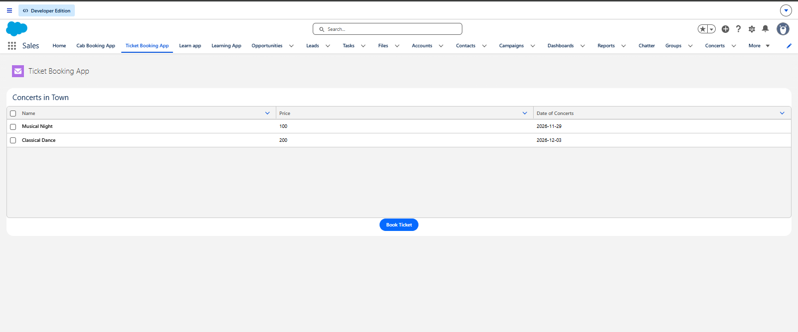
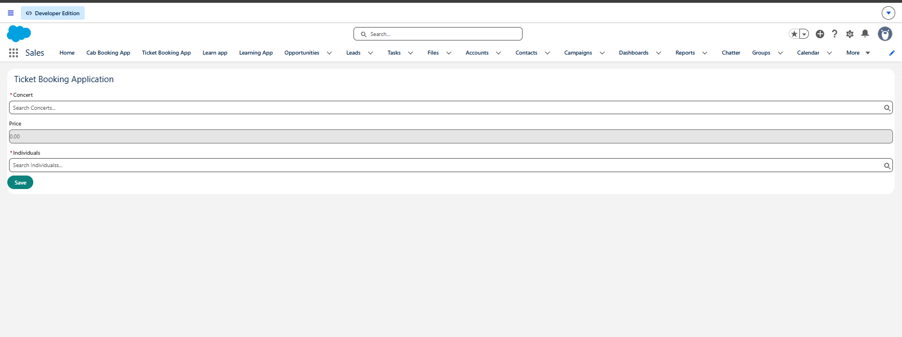

# Ticket Booking Application

A concert ticket booking app built on Salesforce using Apex, SOQL and Lightning Web Components.

## Features
- Browse upcoming concerts in a listing built with `lightning-datatable` and `@wire`
- Book tickets through a booking form that auto-fills the ticket price using an imperative Apex call
- Toast notifications and a confirmation modal after a booking
- Dynamic pricing: an Apex trigger raises a concert's price by 10% when fewer than 10% of its tickets remain

## Data Model
Three custom objects:
- Concert
- Individual
- Ticket

A custom Lightning app brings the components together.

## Tech Stack
Apex, SOQL, Lightning Web Components (LWC), Salesforce Developer Edition, VS Code

## Project Structure
- `force-app/main/default/classes`: Apex controller with cacheable SOQL methods to fetch upcoming concerts and prices
- `force-app/main/default/triggers`: dynamic pricing trigger
- `force-app/main/default/lwc`: concert listing and booking form components
- `force-app/main/default/objects`: custom objects and fields

## Screenshots

## How to Run
1. Clone this repository.
2. Authorize your Salesforce org with `sf org login web`.
3. Deploy the source with `sf project deploy start`.
4. Open the Ticket Booking app from the App Launcher.

## Author
Diksha Patil - https://www.linkedin.com/in/diksha-patil-941904278
